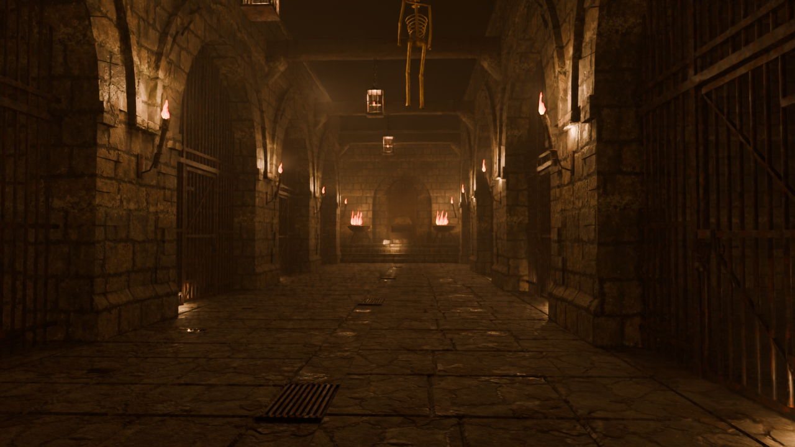
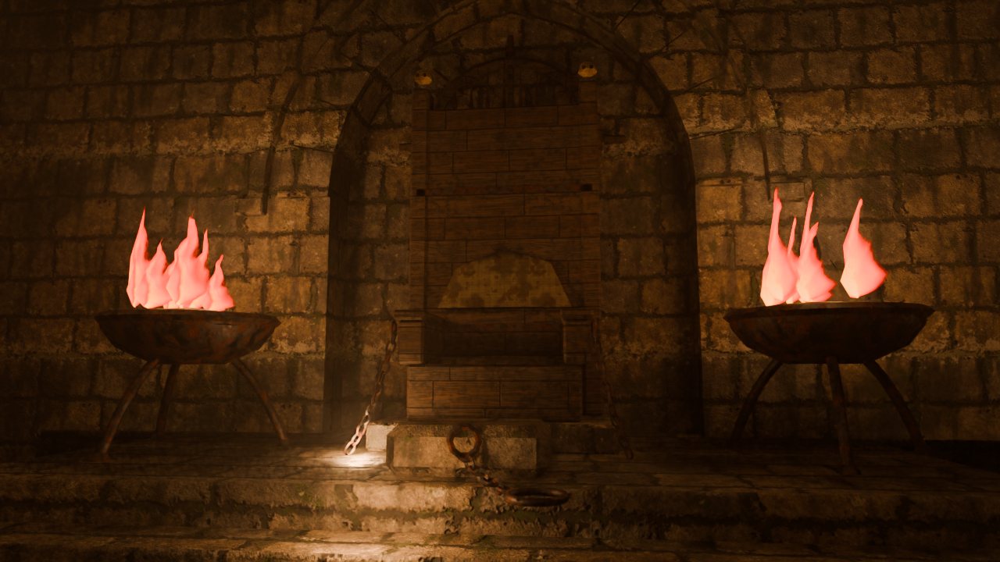
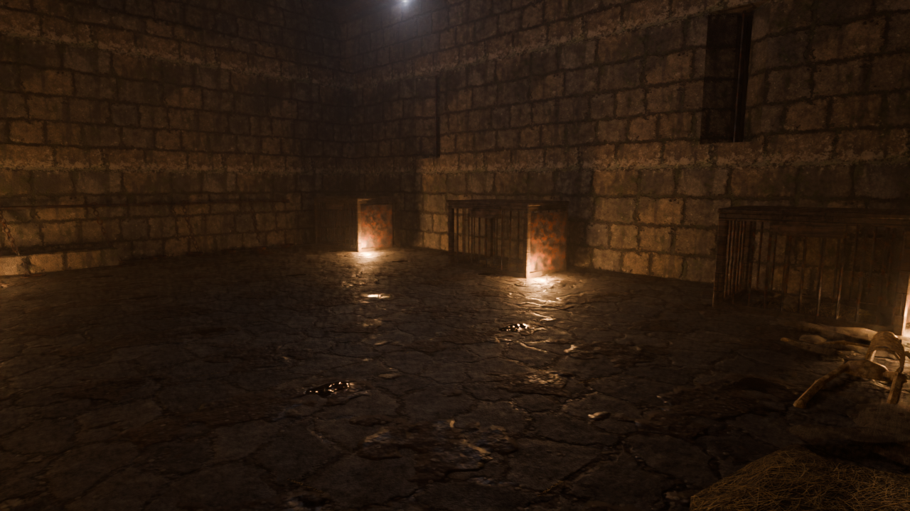
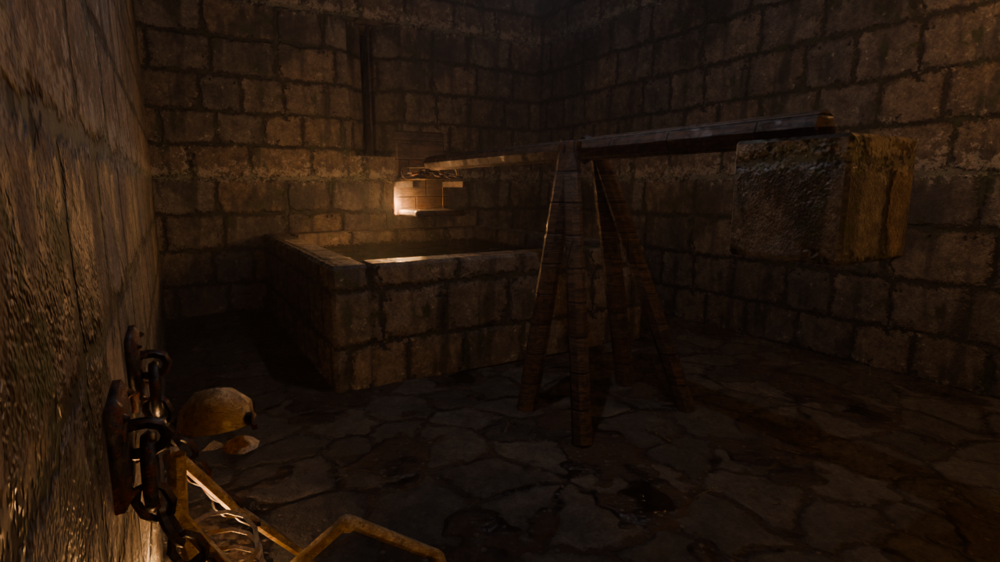

# El Foso de la Leva — mazmorra de rol para Second Life (V3)

La prisión bajo la fortaleza de un señor pirata. Aquí se doblega a los cautivos y se recluta
tripulación: un patio-foso con un canal de agua de mar que sube y baja con la marea, envuelto en
niebla; siete salas de castigo; una única perrera donde los presos viven como perros entre la ropa
interior sucia que les arroja la guardia; y al fondo, sobre un estrado, el trono desde el que el
Señor del Foso ve todas las rejas. Todo es rol consentido entre adultos.

| | |
|---|---|
|  |  |
|  |  |
|  |  |

*(Renders de Cycles con las texturas PBR de `salida/texturas/` y la llama del primer fotograma del flipbook, solo con la luz del fuego y la niebla. Se rehacen con `python foso_mazmorra/scripts/render.py --only 02,06`; `--sin-pbr` vuelve al gris neutro.)*

## Cifras

| | |
|---|---|
| **Primitivas al rezzear** | **143** (límite 150) |
| **Land impact estimado** | **≈ 119** (objetivo 150; la cifra real la da el visor al subir) |
| Huella | 26 × 35,3 m = 917 m² (45 % de la parcela; límite 1.011,5 m²) |
| Triángulos | HIGH 113.439 · MEDIUM 19.272 · LOW 3.814 · LOWEST 1.376 · física 2.590 |
| Pruebas automáticas | 13 de 13 correctas |

## Lo que pasó con las puertas de la V2, y cómo está resuelto

En la V2 no podías entrar en las celdas: la culpa fue mía. SL deja las piezas de malla con física
«Convex Hull», un casco convexo que **tapa los huecos** de las piezas con arcos. Mi solución
dependía de que un script cambiara cada pieza a «Prim». Si el script no llegaba a ejecutarse o no
encontraba las piezas, las puertas quedaban tapadas.

En la V3, **ninguna pieza tapa un paso con su casco convexo**. Cada frente se divide en machones,
cabeza de arco y hoja; los muros, suelos, bóvedas y el atrezzo van por separado y pegados a las
paredes. Así se puede entrar en todas las salas **aunque no ejecutes ningún script**. La prueba
`scripts/qa_fisica.py` lo comprueba en dos escenarios:

| Escenario | Patio, vestíbulo, 8 accesos a salas, estrado y alas de la sala del Señor |
|---|---|
| Con el script de configuración | todo accesible |
| **Sin ningún script** (todo en Convex Hull) | **todo accesible** |

La prueba encontró y corrigió durante el desarrollo:
- los paños de reja montados del lado contrario de la puerta;
- unas gorroneras que bajaban el casco del arco de entrada hasta el suelo;
- unas zancas que convertían la escalinata en un escalón de 55 cm;
- atrezzo repartido por media sala.

Además, `foso_nucleo` reconoce cada pieza **por su tamaño y posición** aunque SL no conserve los
nombres. Después asigna la física fina y **lanza rayos por cada puerta** para avisarte en el chat
si algo bloquea el paso.

## 52 cosas que hay en el Foso

**Arquitectura y atmósfera**
1. Canal de **agua de mar** a lo largo del patio, con **marea** que sube y baja (script).
2. **Niebla salada** que brota del canal y se arrastra por el suelo (partículas).
3. **Bruma baja** en la perrera y **vapor** sobre la cisterna.
4. **Goteo** desde las bóvedas de cada sala.
5. **Telarañas** de hilo real en los arranques de bóveda y en el techo de la perrera.
6. Losas rotas, cascotes junto a los muros, paja pisoteada por el suelo de tierra.
7. Aspilleras abocinadas con barrote en cada sala: la única luz de fuera es la luna.
8. Puerta fortificada: torres con talud, **aspilleras de cruz**, canecillos, parapeto, **rastrillo** que sube dentro del muro.
9. **Escudo del Señor** sobre el arco de entrada, con **dos calaveras clavadas**.
10. **Ajusticiado** colgado de la segunda viga del patio, entre **ganchos de carnicero**: lo primero que ves al entrar.
11. Cinco vigas de roble sobre ménsulas de piedra, con abrazaderas de hierro.
12. Arcos apuntados con dovelas, clave, guardapolvo, impostas y **sillares alternos** en las jambas.

**Fuego vivo (scripts)**
13. **Llamas animadas de partículas** en 24 fuegos: núcleo blanco-amarillo que sube, se ensancha y muere en rojo, sobre una llama de malla que hace de corazón.
14. Cada pieza de fuego tiene su **centro en la base de la llama**, de donde SL emite luz y partículas.
15. **La luz respira**: intensidad, radio y color siguen un ruido suave distinto para cada fuego.
16. **Chasquidos**: destellos al azar con lluvia de chispas.
17. **Boqueadas**: la llama casi se ahoga y se recupera.
18. **Corrientes de aire**: al abrir o golpear una reja, los fuegos a menos de 8 m se tumban y tiemblan.
19. Cuatro **ambientes** que manda el Señor: VIGILIA, PENUMBRA, **JUICIO** (todo rojo, braseros rugiendo) y **TINIEBLAS** (solo arden los braseros del trono).
20. Faroles de jaula colgados de cadenas, con vela gruesa.

**Rejas y cerraduras de rol**
21. Menú al tocar cada reja: **Abrir / Cerrar / Echar llave**.
22. **Solo quien echó la llave puede abrirla** (además del dueño y del Señor sentado en el trono).
23. **Dar llave** a otro avatar cercano.
24. **Condena** de 5 a 120 minutos: se abre sola al cumplirse y se anuncia.
25. **Forzar** la cerradura con d20 (dificultad configurable, enfriamiento por intentos); el carcelero recibe aviso privado.
26. **Clemencia**: el preso suplica y el carcelero recibe un mensaje privado.
27. **Golpear** los barrotes: el estruendo hace temblar los fuegos cercanos.
28. **Tablón de condenas** sobre el tablero de llaves de la guardia: quién tiene cada llave y cuánto queda.
29. Giro de las hojas con **bisagra calculada** y movimiento suavizado; el estado sobrevive a reinicios.

**Las salas**
30. **La Leva**: escritorio de escriba con el **Libro de la Leva** abierto, tintero, pluma y vela.
31. **Alistar**: el libro registra a cada recluta con número y fecha, y lo muestra en texto flotante.
32. **Brasero de marcar** con tres hierros: **Marcar** cuenta las marcas de cada recluta, con chispas.
33. Tablón de pliegos, arcón de ropa de recluta y grilletes de leva en el muro.
34. **El Potro**: rodillos, sogas, grilletes de cuero y rueda; **Tensar / Aflojar** en 5 niveles con texto flotante y frases graduadas.
35. Panoplia de tenazas, mazos y garfios; un esqueleto tendido junto al muro.
36. **El Cepo**: picota con yugo de tres agujeros sobre tarima, y **cepos de pies** con banco; **Escarnio**.
37. **Rueda de tormento** colgada del muro, con calaveras a sus pies.
38. **La Cisterna**: pila de agua salada y **silla de inmersión** sobre un brazo basculante.
39. **Sumergir** hunde de verdad al avatar sentado (gira la pieza y mueve al avatar con ella), con salpicadura; al **Sacar** se anuncian los **segundos bajo el agua**.
40. El que no aguantó: **esqueleto encadenado**, sentado contra el muro.
41. **La Perrera** (C05+C06, la única celda de estancia, doble y con techo de vigas).
42. **Tres casetas** de madera y hierro con paja y collar: **Nombrar perro** cuelga una placa con el nombre y el amo.
43. Barra de traílla con anillas, **cadenas y collares**; comedero corrido y **escudillas**; **Rancho** y **Agua**.
44. **Montones de ropa interior masculina** de soldados y esclavos (calzones, taparrabos, camisas) arrojados para humillar.
45. **Arrojar ropa**: desde el cesto de la colada de la guardia, una lluvia de trapos cae por la trampilla del techo de la perrera.
46. **Las Jaulas**: dos jaulas de horca colgadas de la bóveda (una con su **viejo inquilino**); **Izar / Bajar** sube y baja al preso con la jaula, balanceándose.
47. **El Mástil**: palo mayor astillado de un barco apresado como poste de azotes; **Azotar** lleva la cuenta en texto flotante. Gatos de nueve colas y **barril de sal** para las heridas.
48. **Cuerpo de guardia**: mesa con jarras, dados, vela y **una daga clavada** (**Dados**: 2d6, **Brindis**); **ancla** de un barco apresado; armero de picas; **tablero con una llave por sala**.
49. **Torno del rastrillo** con cadena y **campana de la Leva** (Subir, Bajar, Campana).
50. **El trono del Señor**: respaldo alto con corona de púas, columnillas rematadas en **calaveras**, piel sobre el asiento, cadenas desde los brazos y el **timón de su barco** en la hornacina.
51. Desde el trono, el Señor: **Abrir todas / Cerrar todas**, **Ambiente**, **Juicio** (elige a alguien y una sala: queda encerrado 30 min con la llave del Señor y todo se tiñe de rojo), **Campana**, **Libro**. Delante, la **piedra de rodillas** con argolla y collar (**Presentar**).
52. **Voces en la oscuridad**: cuando hay gente, cada pocos minutos ocurre algo inquietante en el chat («Una calavera rueda sola en Las Jaulas y se detiene mirándote»…). Admite tus sonidos.

Y en la sala del Señor: estandartes desgarrados, pacas, el cofre del botín entreabierto, barriles de ron y picas con calaveras en los rincones.

## Materiales PBR por bloques

Todas las piezas tienen **las mismas 8 caras en el mismo orden**:

| Cara | 0 | 1 | 2 | 3 | 4 | 5 | 6 | 7 |
|---|---|---|---|---|---|---|---|---|
| Material | Piedra | Suelo | Madera | Hierro | Tela y cuero | Hueso | Paja | Llama |

El agua va aparte, en `P_Agua` y `C04_Agua`.

Con **`foso_materiales.lsl`** pones tus materiales PBR en la raíz y una nota «materiales» como
esta, y al tocar la raíz cada uno se aplica a todas sus caras del edificio:

```
Piedra = Mi piedra húmeda
Suelo = Losas viejas
Madera = Roble podrido
Hierro = Hierro forjado oxidado
Tela = Lino sucio
Hueso = Hueso viejo
Paja = Paja seca
Agua = Agua de mar
```

A mano también funciona: con *Select Face* y la cara 3, por ejemplo, eliges el hierro de cualquier pieza.

Las UV son de caja en coordenadas de mundo, así que las texturas repetibles casan entre piezas.
La escala es 1 repetición = 2 m en piedra y suelo, 1 m en madera y paja, 0,5 m en hierro, 0,6 m en
tela y 0,3 m en hueso. Si hace falta, ajústala con *Repeats per meter*. La cara 7 (llama) la gestiona el script del fuego: no le pongas PBR.

### Texturas PBR procedurales

`python foso_mazmorra/scripts/texturas_pbr.py` (unos 25 s, sólo numpy + pillow) genera en `salida/texturas/` un juego repetible y sin costuras por material (`<Material>_basecolor.png` sRGB, `_normal.png` glTF/OpenGL +Y arriba, `_orm.png` con R oclusión, G rugosidad, B metalicidad; 1024x1024) y la hoja `_muestrario.png`; y en `salida/materiales_pbr/<Material>.glb` un material glTF 2.0 con las tres imágenes embebidas y un quad, listo para el subidor de materiales de Second Life. La escala de cada textura coincide con los metros por repetición del mapeado (Piedra 2 m, Hierro 0,5 m...). El propio script comprueba la continuidad borde-borde y valida cada .glb.

## Texturas PBR y efectos

Todo lo de esta sección es opcional: sin ello el Foso funciona igual, con colores planos y la
partícula de fuego por defecto.

**Materiales PBR (8 `.glb`).** `scripts/texturas_pbr.py` deja en `salida/materiales_pbr/` un
`.glb` por material: Piedra, Suelo, Madera, Hierro, Tela, Hueso, Paja y Agua.

1. **Build → Upload → Material** y elige `salida/materiales_pbr/Piedra.glb`. Repite con los ocho.
   Cada uno sube color base, normal y ORM (oclusión, rugosidad y metal) de una vez.
2. Mete los ocho materiales en el contenido de la raíz junto a `foso_materiales.lsl` y una nota
   «materiales» como la de la sección anterior (`Piedra = Piedra`, `Suelo = Suelo`...; vale el
   nombre del material en el inventario o su UUID).
3. Toca la raíz: cada material se aplica a su cara (0 a 6) en todas las piezas y el Agua a
   `P_Agua` y `C04_Agua`. Las texturas repiten sin costuras y su escala ya casa con las UV
   (1 repetición = 2 m en piedra, 0,5 m en hierro...): no cambies *Repeats per meter*.

**Texturas de efectos (7 PNG).** `scripts/sprites_efectos.py` las genera en `salida/efectos/`.
Sube cada una con **Build → Upload → Image**; en el inventario, clic derecho → **Copiar UUID** y
pégalo entre las comillas de su constante al principio de `foso_fuego.lsl` (la plantilla está en
`lsl/plantillas/`; si vuelves a ejecutar la build, pega los UUID en la plantilla). Guarda el script.

| PNG | Constante | Efecto |
|---|---|---|
| `fuego_flipbook.png` | `TEXTURA_FLIPBOOK` | Llamas de malla animadas: la cara 7 reproduce un bucle de 4x4 fotogramas (velocidad `FPS_FUEGO`, cada fuego algo distinto). |
| `llama_particula.png` | `TEXTURA_LLAMA` | Partículas de llama sobre antorchas y braseros. |
| `humo.png` | `TEXTURA_HUMO` | Humo que sube de los braseros, alternando con la llama. |
| `niebla.png` | `TEXTURA_NIEBLA` | Niebla del canal, bruma y vapor. |
| `chispa.png` | `TEXTURA_CHISPA` | Chispas de los chasquidos del fuego, la marca y el azote. |
| `gota.png` | `TEXTURA_GOTA` | Gotas que caen de las bóvedas. |
| `proyector_fuego.png` | `TEXTURA_PROYECTOR` | Luz proyectora con sombras en los braseros del trono, el farol de la perrera y los faroles del patio. |

Las luces proyectoras y sus sombras solo se ven con las sombras activadas en el visor:
**Preferencias → Gráficos → Sombras: «Sol/Luna + proyectores»**. Proyectan hacia el −Z local de
la pieza (hacia abajo). En TINIEBLAS se apagan y el flipbook se para en los fuegos que se apagan.
Una constante vacía (`""`) deja ese efecto como antes.

## Instalación en Second Life

1. **Build → Upload → Model** → `salida/Foso_V3_HIGH.dae`.
2. Pestaña *Level of Detail*: Medium, Low y Lowest → **Load from file** → `Foso_V3_MEDIUM.dae`, `Foso_V3_LOW.dae`, `Foso_V3_LOWEST.dae`.
3. Pestaña *Physics* → **From file** → `Foso_V3_PHYS.dae`. **No pulses Analyze.**
4. Escala **1,0**. *Calculate weights & fee* muestra el land impact real. Sube.
5. Rezéalo y, en el contenido de la raíz, crea un script nuevo por cada archivo de `lsl/` (pegando el texto), **en este orden**:
   1. `foso_nucleo` (reconoce piezas, asigna la física y hace el diagnóstico de puertas);
   2. `foso_puertas`, `foso_fuego`, `foso_asientos`, `foso_salas`, `foso_trono`;
   3. `foso_pose`, **6 u 8 veces** (SL numera las copias; cada una anima a un avatar);
   4. opcionales: `foso_ambiente` (marea y voces) y `foso_materiales` (PBR).
6. Si tienes animaciones, ponlas en la raíz con estos nombres:
   `foso_senor`, `foso_rodillas`, `foso_potro`, `foso_picota`, `foso_cepos`, `foso_silla`, `foso_perro`, `foso_jaula`, `foso_mastil`, `foso_escriba`, `foso_guardia`, `foso_torno`.
   Si falta alguna, se usa una animación de serie de SL.
7. Opcional: pon UUID de sonidos en las variables `SONIDO_*` de `foso_puertas` y en `SONIDOS` de `foso_ambiente`. Para llamas aún más realistas, pon en `TEXTURA_LLAMA` de `foso_fuego` el UUID de una textura de llama con alfa.

Si mueves o giras el edificio, reinicia los scripts con todo cerrado (*Reset Scripts*). Así se vuelven a medir las bisagras.

## Lo que no he podido comprobar

No hay visor de SL en este entorno. Todo lo anterior está comprobado con pruebas locales sobre los
mismos archivos que subes: geometría, LOD, caras, física en dos escenarios y coherencia de nombres
entre modelo y scripts. Los scripts LSL no se han compilado en un visor. Si alguno da un error al
guardarlo, cópialo tal cual y lo corrijo. El land impact es una estimación con la fórmula del visor.

## Archivos

* `salida/Foso_V3.blend`: fuente editable.
* `salida/Foso_V3_*.dae`: HIGH, MEDIUM, LOW, LOWEST y PHYS.
* `salida/Informe_V3.json`: por pieza, tipo, tamaño, triángulos, radio, peso de cada LOD, land impact estimado y asiento.
* `salida/QA_fisica.json`, `salida/QA_fisica_configurado.png` y `salida/QA_fisica_sin_scripts.png`: prueba de circulación.
* `lsl/`: scripts listos para pegar; se generan desde `lsl/plantillas/` con la tabla de piezas.
* `scripts/pieces_v3.py`: todo el diseño. `scripts/build_foso.py`: lo construye y exporta. `tests/test_foso.py`: las 13 pruebas.
* `docs/HANDOFF_ES.md` y `docs/HANDOFF_EN.md`: el encargo original y su traducción.

```
pip install bpy
python foso_mazmorra/scripts/build_foso.py
python foso_mazmorra/tests/test_foso.py
python foso_mazmorra/scripts/render.py
```
