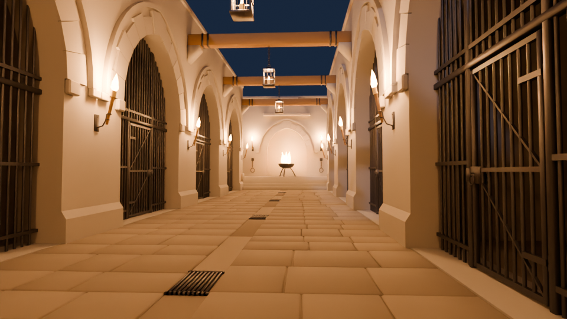
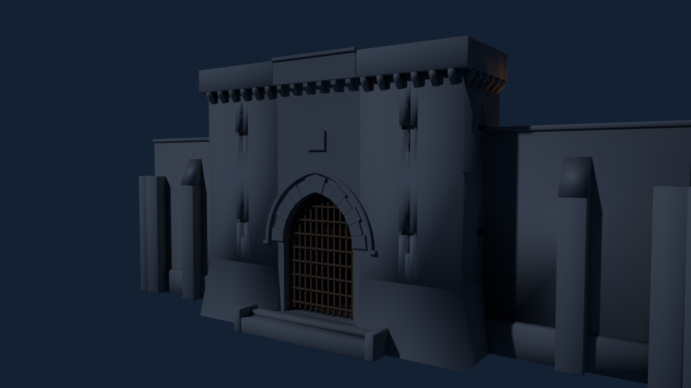
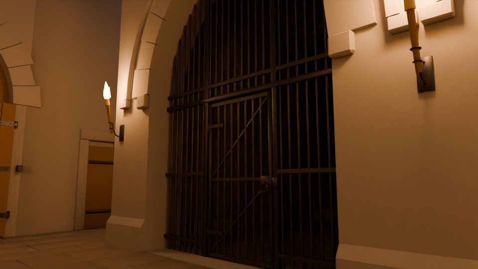
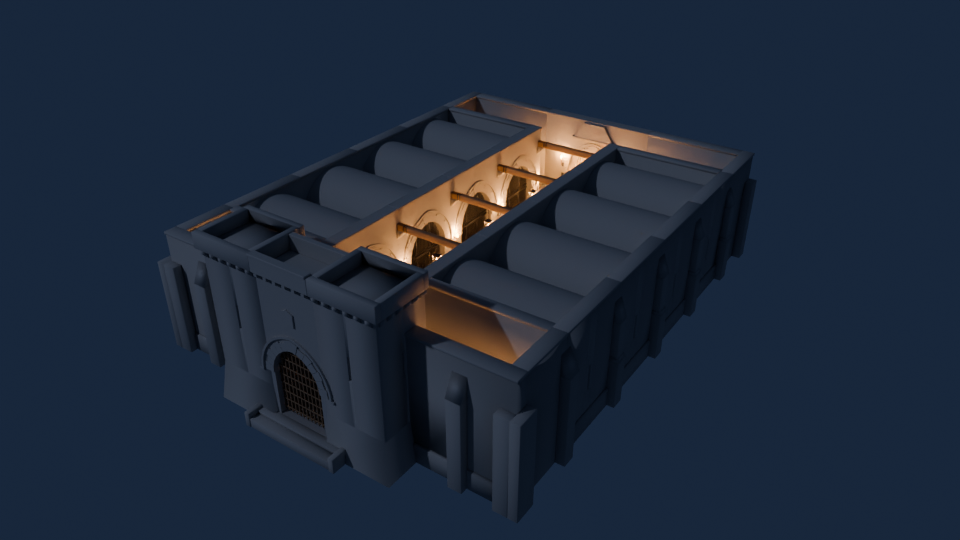

# El Foso — mazmorra-perrera para Second Life (V2, concepto nuevo)

Edificio de fantasía medieval oscura para roleplay en Second Life, hecho **desde cero** a partir del
encargo del handoff (`docs/HANDOFF_ES.md`, traducción en `docs/HANDOFF_EN.md`). No reutiliza la
geometría de la V1: es un concepto propio que mantiene sus requisitos (ocho celdas grandes, rejas,
portones, cadenas y herrajes modelados en 3D, sin texturas y con UV listas para las tuyas).

| Vista | |
|---|---|
|  |  |
|  |  |

## El concepto

Un **foso**: un patio largo y estrecho encajonado entre muros de 7,6 m, con las celdas abiertas a
él como los nichos de un circo de bestias. Se entra por una **puerta fortificada** con dos torres,
rastrillo y portón de madera claveteada; al fondo, sobre un **estrado**, el gran **brasero** del
perrero arde delante de una hornacina apuntada. La luz viene solo del fuego: antorchas en cada
machón, faroles de jaula colgados de las vigas y el brasero. Las celdas son penumbra.

```
                   N
   ┌────────────────────────────────┐
   │ sala del perrero: estrado,     │
   │ hornacina y brasero            │
   ├──────────┬──────────┬──────────┤
   │   C04    │          │   C08    │
   ├──────────┤          ├──────────┤
   │   C03    │  patio   │   C07    │
   ├──────────┤   6 m    ├──────────┤
   │   C02    │          │   C06    │
   ├──────────┤          ├──────────┤
   │   C01    │          │   C05    │
   ├──────────┴──────────┴──────────┤
   │           vestíbulo            │
   └───[torre]═ paso + rastrillo ═[torre]───┘
                escalinata
                   S
```

* **Huella:** 26,0 × 35,3 m = **918 m²** (45 % de la parcela de 2.023 m²; límite 1.011,5 m²).
  Altura: 7,6 m los muros, 10,6 m las torres. La base baja 0,4 m bajo el suelo para tapar terreno irregular.
* **8 celdas** de 5,15 × 7,8 m libres (≈ 40 m²), cuatro por ala, cada una con:
  bóveda de cañón con dos arcos fajones (retirable), aspillera abocinada al exterior, yacija de piedra
  con bordillo de madera, montón de paja, pesebre de piedra, cubo de duelas, huesos roídos y una
  **cadena de eslabones reales** que cae de una argolla y acaba en un collar sobre el suelo.
* **Frente de celda:** arco apuntado de 3,8 m con dovelas, clave, guardapolvo, impostas y sillares
  alternos en las jambas; reja de barrotes redondos que entran en la piedra y **puerta practicable**
  de 1,4 × 2,6 m con tornapuntas, nudillos de bisagra sobre pernios, cerradura y argollas.
* **Patio:** 6 m de ancho, enlosado irregular por hiladas, canal de desagüe central con rejillas,
  cinco vigas de madera sobre ménsulas de piedra, tres faroles de jaula y diez antorchas.
* **Puerta fortificada:** torres con talud, aspilleras de cruz, canecillos y parapeto (sin almenas
  de juguete), arco con escudo liso para tu emblema, rastrillo que sube dentro del muro y dos hojas
  de madera claveteada con herrajes por ambas caras.
* **Sala del perrero:** estrado de 0,9 m con escalinata (pasillos laterales libres), hornacina
  apuntada con campana de humos, gran brasero de trípode, argollas con collares, pacas y barriles.

## Archivos (`salida/`)

| Archivo | Para qué |
|---|---|
| `Foso_V2.blend` | Fuente editable. Colecciones `MALLA \| HIGH`, `LOD \| MEDIUM/LOW/LOWEST`, `FISICA` |
| `Foso_V2_HIGH.dae` | Modelo principal que se sube |
| `Foso_V2_MEDIUM.dae`, `_LOW.dae`, `_LOWEST.dae` | Niveles de detalle (nombres `_LOD2`, `_LOD1`, `_LOD0`) |
| `Foso_V2_PHYS.dae` | Física (cajas y una rampa; nombres `_PHYS`) |
| `Informe_V2.json` | Por pieza: tamaño, triángulos por nivel, radio, peso de cada LOD y LI estimado |
| `QA_fisica.json`, `QA_fisica_mapa.png` | Prueba de circulación (ver abajo) |
| `Pruebas_V2.json` | Resultado de las 12 pruebas automáticas |
| `01…06_*.png` | Renders de presentación (Cycles, materiales grises, solo luz de fuego y luna) |

Scripts LSL en `lsl/`; generador y pruebas en `scripts/` y `tests/`.

## Subirlo a Second Life

1. **Build → Upload → Model…** y elige `Foso_V2_HIGH.dae`.
2. Pestaña **Level of Detail**: en Medium, Low y Lowest elige **Load from file** y carga
   `Foso_V2_MEDIUM.dae`, `Foso_V2_LOW.dae` y `Foso_V2_LOWEST.dae`. *No* uses «Generate».
3. Pestaña **Physics**: «Step 1» → **From file** → `Foso_V2_PHYS.dae`. **No pulses Analyze** ni
   Simplify: son cajas pensadas para quedarse como malla de triángulos.
4. **Upload options**: escala 1,0; sin texturas; no marques «Include skin weight».
5. **Calculate weights & fee**: aquí aparece el land impact real. Anótalo.
6. Rezea el modelo, mete **`foso_configurar.lsl`** en el contenido de la raíz y espera el mensaje.
   Asigna el tipo de física correcto a cada una de las 126 piezas y enciende los fuegos; luego se borra solo.
7. Mete **`foso_puertas.lsl`** en la raíz: tocar una puerta de celda, una hoja del portón o el
   rastrillo la abre y la cierra. `ACCESO` admite `TODOS`, `GRUPO` o `DUENO`.
8. Opcional: **`foso_fuego.lsl`** hace parpadear las luces.
9. Comprueba la física con **Develop → Render Metadata → Physics Shapes** (Ctrl+Alt+Q activa el menú Develop).

> Por qué importa el paso 6: SL suele dejar las piezas de malla en *Convex Hull*. Un casco
> convexo de una pieza con hueco (un frente con su arco, una celda) **tapa el hueco**, y eso es lo
> que impedía entrar en las celdas en la V1. Las piezas estructurales deben ser **Prim**.

### Tipos de física

| Piezas | Tipo | Motivo |
|---|---|---|
| `_Muros`, `_Frente`, `_Suelo`, `_Boveda`, suelos `P*/V_/N_/G_Suelo*`, `G_Torre*`, `G_Arco`, `G_Muro*`, `V_Muro*`, `N_Muro*`, `N_Estrado`, `G_Escalinata` | **Prim** | Usan la física subida, con sus huecos |
| `_Puerta`, `G_Hoja_O/E`, `G_Rastrillo` | **Convex Hull** | Losas que giran o suben con el script |
| `_Reja`, `_Cadena`, `_Paja`, `_Comedero`, `_Viga`, `_Farol`, `*Antorcha*`, `N_Brasero`, `N_Argollas`, `N_Pacas`, `N_Barriles` | **None** | Decoración; la reja ya está en la física del `_Frente` |

Todas las piezas «Prim» miden más de 0,5 m en cada eje (si no, SL las pasa a casco convexo; hay una prueba que lo vigila).

## Física: qué se corrigió y cómo se ha comprobado

`scripts/qa_fisica.py` recorre el edificio en una cuadrícula de 0,2 m con un avatar de radio 0,25 m
(cuerpo de 0,35 a 1,9 m sobre el suelo), sobre exactamente las cajas que se exportan:

* **Accesible desde la escalinata exterior:** patio, vestíbulo (ambos lados), las 8 celdas, estrado y
  las dos alas de la sala del perrero → **todo sí**.
* **Zonas atravesables** (piedra visible donde la física deja pasar ≥ 5 cm): **0**.
* **Puntos accesibles sin suelo físico:** **0**.
* **Paredes invisibles** junto a zonas transitables: 0,04 m² en cada torre (la esquina del talud inclinado).

Fallos que la prueba encontró durante el desarrollo y que están corregidos (son del tipo de los que
describía el handoff de la V1):

1. **Umbral sin suelo:** entre el patio y la celda faltaba el suelo físico de 0,8 m bajo el arco; el
   avatar caía o tropezaba al entrar. Ahora el umbral es física continua.
2. **Paso de la puerta estrechado 30 cm** por lado sin motivo visible.
3. **Alas de la sala del perrero inaccesibles** sin saltar del estrado: la escalinata ahora deja
   pasillos de 0,8 m y la rampa física sigue las aristas de los peldaños (≈ 35°).
4. Zancas de la escalinata exterior y talud de las torres sin física.

Otras decisiones: la reja bloquea con una **losa fina en el plano de los barrotes** (se puede entrar
en el hueco del arco); las hojas tienen su propia física y se mueven con ella; la escalinata usa una
**rampa invisible** para subir sin saltitos.

**Lo que no se ha podido probar aquí:** no hay un visor de SL en este entorno. Las pruebas son
locales sobre los mismos datos que se suben; falta confirmarlo dentro de SL (paso 9).

## Land impact

En SL el coste de descarga se calcula por pieza ponderando cada LOD por el área en que se ve, que
depende del **radio** de la pieza. En piezas grandes manda el LOW (≈ 60 %); en las pequeñas, el
LOWEST (≈ 90 %). Por eso:

* piezas grandes (muros, frentes, torres): HIGH rico, MEDIUM con solo las caras que se ven desde
  lejos, LOW y LOWEST mínimos (se ven a más de 100 m);
* piezas pequeñas (antorchas, faroles, brasero): MEDIUM casi igual al HIGH, LOWEST mínimo;
* el detalle caro (rejas, cadenas, rastrillo) va en piezas separadas de radio pequeño.

| Nivel | Objetos | Triángulos |
|---|---:|---:|
| HIGH | 126 | 100.365 |
| MEDIUM | 126 | 25.765 |
| LOW | 126 | 6.251 |
| LOWEST | 126 | 1.061 |
| PHYS | 126 | 2.818 |

**Estimación: ≈ 112 LI** (fórmula de streaming cost del visor con un tamaño comprimido aproximado;
peso de servidor 126 × 0,5 = 63). Objetivo: 150. **Es una estimación, no una medida**: la cifra real
es la del paso 5. Si sale por encima de 150, las primeras palancas están en `Informe_V2.json` (campo
`li_descarga_est` por pieza): `G_Arco`, `G_Rastrillo`, `_Reja` y `_Muros`.

Las cadenas, rejas y herrajes son geometría real; no hay alfas.

## Texturas y UV

* **Sin texturas ni imágenes.** Materiales planos con nombre:

| Material | Uso | Cara SL |
|---|---|---|
| `Llama` | fuego (pon fullbright/glow; lo hace el script) | siempre la **cara 0** en las piezas con fuego |
| `Piedra` | muros, arcos, bóvedas, torres | en orden después de Llama |
| `Suelo` | losas, tierra de las celdas, agua del pesebre, brasas | |
| `Madera` | vigas, portón, rastrillo, cubo, bordillos | |
| `Hierro` | rejas, cadenas, herrajes, faroles | |
| `Paja` | paja, estopa de las antorchas, velas, huesos | |

* **UV de caja en coordenadas de mundo**, con repetición: 1 unidad UV = 2 m en piedra y suelo,
  1 m en madera y paja, 0,5 m en hierro. Las texturas repetibles (*tileables*) casan entre piezas
  vecinas sin costuras y mantienen la misma densidad en todo el edificio. Ajusta la escala con
  *Repeats per meter* o *Repeats per face* en SL.
* Con texturas PBR (GLTF material) de piedra, roca y hierro forjado el resultado gana mucho.
  El normal map es lo que más aporta a la piedra sin subir LI.

## Ambiente recomendado en SL

* Entorno nocturno o de crepúsculo (EEP) con niebla baja y luz de luna azulada.
* *Preferences → Graphics*: Advanced Lighting / PBR con sombras para ver las luces de las antorchas.
* `RenderVolumeLODFactor` 2 o más (Firestorm usa 2 por defecto) para mantener el HIGH a más distancia.

## Regenerar y probar

```
pip install bpy            # o usa Blender 4.2+ / 5.x: blender -b --python ...
python foso_mazmorra/scripts/build_foso.py   # Blender + DAE + Informe (≈ 15 s)
python foso_mazmorra/tests/test_foso.py      # regenera y pasa 12 pruebas, incluida la de física
python foso_mazmorra/scripts/render.py       # renders (Cycles CPU; --fast para borradores)
```

`scripts/pieces.py` contiene todo el diseño, con cotas al principio (`FL`, `WT`, `YP`…). Cada pieza
se construye para cada LOD y declara sus cajas de física; las variaciones (posición de cadenas,
paja, huesos) son aleatorias con semilla fija, iguales en todos los niveles.

## Pruebas automáticas (12/12 correctas)

Mismos 126 objetos en los cinco niveles con los sufijos de SL · sin imágenes ni texturas en los DAE ·
índices válidos · materiales de cada LOD dentro del HIGH y ≤ 8 por pieza · **misma caja en los
cinco niveles** (SL estira LODs y física a la caja del HIGH; si no coinciden, se deforman) · sin
triángulos degenerados · huella ≤ 1.011,5 m² · LI estimado ≤ 130 · piezas Prim ≥ 0,5 m · llama en la
cara 0 · circulación completa · nombres que usan los scripts LSL.

## Para comparar con otras IAs

Criterios del handoff y dónde verlos aquí: proporción y estilo (renders); contactos de herrajes
(placas y pernios encastrados en el muro, grapas que atraviesan la placa, argollas pasadas por las
grapas, eslabones entrelazados con el paso calculado, collar enganchado al último eslabón);
circulación (`QA_fisica.json` y mapa); LI (estimado ≈ 112, **pendiente de medir en visor**); UV
(caja en mundo, coherentes entre LODs porque se calculan igual); reproducibilidad (un comando
regenera todo); qué no se ha comprobado (todo lo que requiere el visor de SL).
