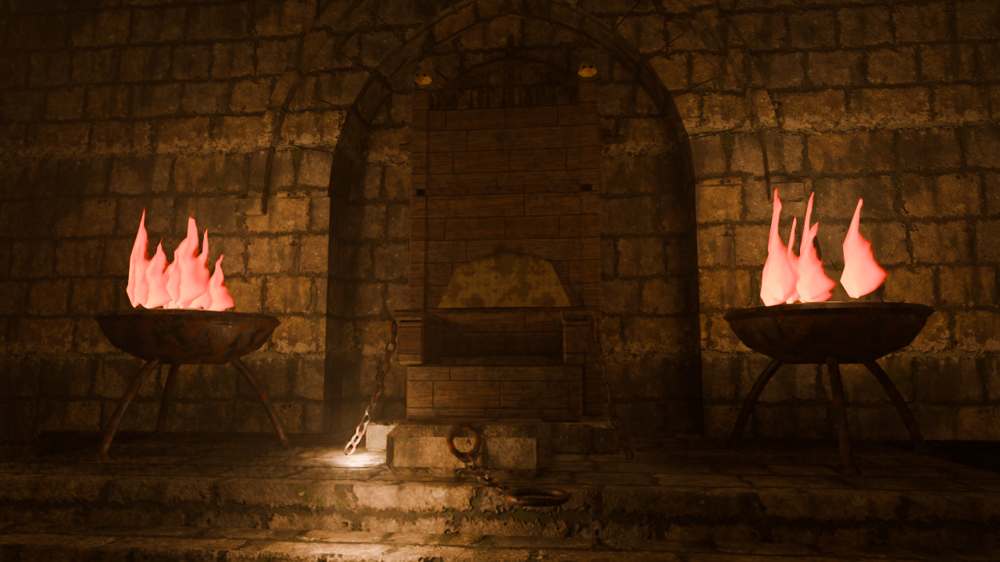
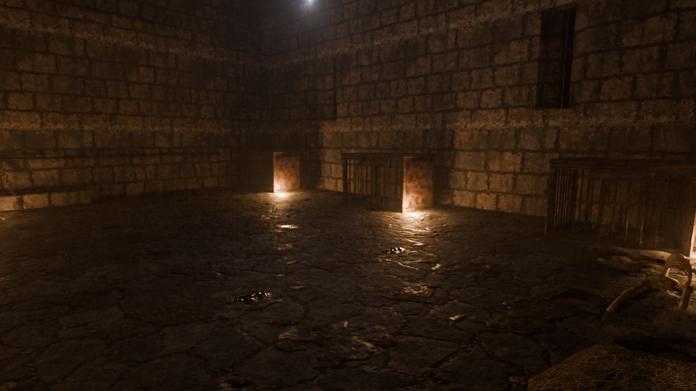
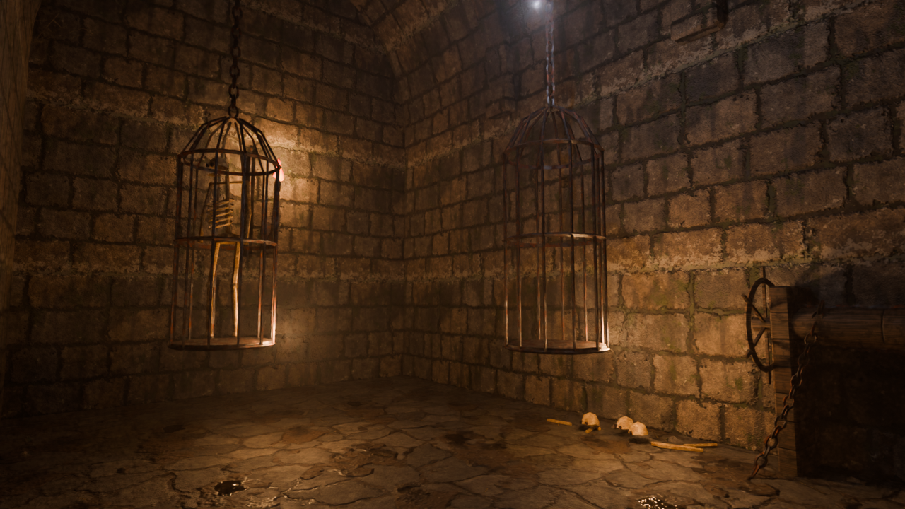
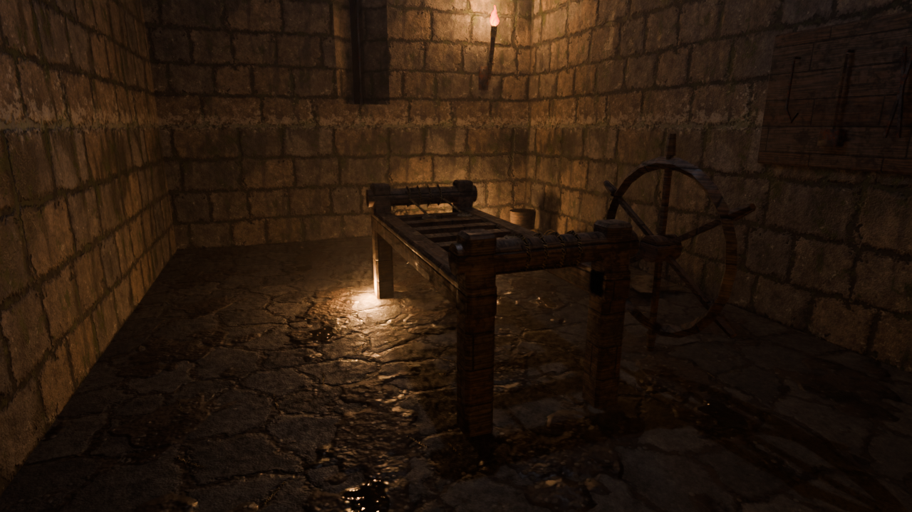

# The Pit — a roleplay dungeon for Second Life

The prison under a pirate lord's fortress. Captives are broken here and crews are pressed into
service: a moat-yard with a sea-water channel that rises and falls with the tide under the fog;
seven punishment rooms; a single kennel where the prisoners live like dogs among the dirty
underwear the guards throw at them; and at the far end, on a dais, the throne from which the Lord
of the Pit watches every grille. All roleplay is between consenting adults.

| | |
|---|---|
|  |  |
|  |  |
|  |  |

*(Cycles renders with the PBR textures from `output/textures/` and the first frame of the flame
flipbook, lit only by the fire and the fog.)*

## Figures

| | |
|---|---|
| **Prims when rezzed** | **143** (limit 150) |
| **Estimated land impact** | **≈ 119** (target 150; the viewer shows the real figure at upload) |
| Footprint | 26 × 35.3 m = 917 m² (45 % of the parcel; limit 1,011.5 m²) |
| Triangles | HIGH 113,439 · MEDIUM 19,272 · LOW 3,814 · LOWEST 1,376 · physics 2,590 |
| Automated tests | 15 of 15 pass (including every switch wired and every script compiling with lslint) |

## Everything can be switched off

Every effect and every roleplay feature has an on/off switch. The switches are stored inside the
build (linkset data): they apply at once in every script, survive resets and travel with copies.

* **`/7 settings`** — a menu by category (also the **Settings** button in the throne menu, owner only).
* **`/7 off fog`**, **`/7 on fog`** — one feature by name.
* **`/7 status`** — what is switched off.
* **`/7 all on`**, **`/7 all off`** (a still, silent build), **`/7 lowlag`** (no flicker, smoke,
  sparks, projectors, draughts, fog, drips, tide or voices; the RP stays).
* **`/7 help`** — every owner command.

| Category | Switches |
|---|---|
| Fire & light | `fire` (master), `flames`, `lights`, `flicker`, `glow`, `flipbook`, `smoke`, `sparks`, `projectors`, `gusts` |
| Atmosphere | `fog`, `drips`, `bursts`, `moods`, `tide`, `voices`, `sounds` |
| Doors | `doors` (master), `locks`, `sentences`, `escape`, `pleas`, `door_sounds`, `bell`, `board` |
| Rooms | `furniture` (master), `rack`, `stocks`, `cistern`, `cages`, `mast`, `kennel`, `guardroom`, `kneeling`, `seats` |
| Throne | `throne`, `lord_keys`, `judgement`, `muster_book`, `branding` |
| System | `narration` (off = RP lines go only to whoever clicked), `hovertext`, `rename`, `physics`, `diagnose`, `auto_materials` |

Other owner commands: `/7 doors` (find the doors again), `/7 doors reset`, `/7 materials` (apply
the PBR materials now), `/7 diagnose` (check that every doorway is clear).

## Installing in Second Life (fewest clicks)

Run `python the_pit/scripts/package_sl.py` (or take the delivered `ThePit_SL_A_model_and_scripts.zip`
and `ThePit_SL_B_bulk_upload.zip`, unzipped into one folder) and follow `INSTALL.txt`:

1. **Model, one upload**: Build → Upload → Model → `1_model/ThePit.dae`. The LOD and physics
   files (`ThePit_LOD2/_LOD1/_LOD0/_PHYS.dae`) load by themselves because of their names. Scale
   1.0 → *Calculate weights & fee* → *Upload*.
2. **Materials and effects, one upload**: Build → Upload → **Bulk** → `2_bulk_upload/`, Ctrl+A →
   Upload (8 PBR materials + 7 effect textures).
3. Rez the build, Edit → **Contents**, and drag in the 8 materials and 7 textures at once.
4. Six scripts, any order: *New Script*, paste, save — `pit_core`, `pit_control`, `pit_doors`,
   `pit_fire`, `pit_rooms`, `pit_throne`. No pose copies, no notecard, no UUIDs to paste.

Everything starts by itself. Optional: animations (`pit_lord`, `pit_kneel`, `pit_rack`,
`pit_pillory`, `pit_stocks`, `pit_chair`, `pit_dog`, `pit_cage`, `pit_mast`, `pit_scribe`,
`pit_guard`, `pit_winch`; a missing one falls back to a built-in SL animation) and sounds
(`door_creak`, `lock_clank`, `portcullis_chain`, `press_gang_bell`, `ambient…`) dropped into the
same Contents.

**Already uploaded the first (Spanish) release?** Don't upload the model again. Delete the old
scripts from the root and do steps 2–4: `pit_core` renames every piece to its English name by
its size and position, and keeps your locks and the muster book.

## PBR materials by block

Every piece has **the same 8 faces in the same order**:

| Face | 0 | 1 | 2 | 3 | 4 | 5 | 6 | 7 |
|---|---|---|---|---|---|---|---|---|
| Material | Stone | Floor | Wood | Iron | Cloth & leather | Bone | Straw | Flame |

The water has its own pieces, `P_Water` and `C04_Water`.

1. **Build → Upload → Bulk** with the eight `.glb` files of `output/pbr_materials/` (Stone, Floor,
   Wood, Iron, Cloth, Bone, Straw, Water). Each uploads base colour, normal and ORM (occlusion,
   roughness, metal).
2. Drop the eight materials into the root's Contents (`pit_control` handles them). **They are
   applied at once** to every piece: each material goes to the block whose name it contains. No
   notecard needed. If your materials have other names, add a notecard called `materials` (a ready-made
   one is `lsl/materials_notecard.txt`): `Stone = <material name or UUID>`, one line per block.
3. `/7 materials` applies them again. The textures tile seamlessly and their scale already matches
   the UVs (1 repeat = 2 m of stone, 0.5 m of iron...): don't change *Repeats per meter*.

By hand also works: with *Select Face* and face 3, for example, you pick the iron of any piece.
Face 7 (flame) belongs to the fire script: don't put PBR on it.

## Effect textures (7 PNGs)

Optional: without them The Pit works the same, with plain flames and the default fire particle.
Upload the PNGs from `output/effects/` (in the same **Bulk** upload as the materials) and drop
the textures into the root's Contents **keeping their names**. `pit_fire` finds them by name; nothing to paste.

| PNG | Effect |
|---|---|
| `fire_flipbook.png` | Animated mesh flames: face 7 plays a 4×4 frame loop (each fire at a slightly different speed). |
| `flame_particle.png` | Flame particles on torches and braziers. |
| `smoke.png` | Smoke rising from the braziers, alternating with the flame. |
| `fog.png` | Channel fog, kennel mist, cistern steam. |
| `spark.png` | Sparks from fire crackles, branding and lashes. |
| `drip.png` | Drips falling from the vaults. |
| `fire_projector.png` | Projector light with shadows on the throne braziers, the kennel lantern and the yard lanterns. |

Projector lights and their shadows only show with shadows on in the viewer: **Preferences →
Graphics → Shadows: "Sun/Moon + Projectors"**.

## 52 things in The Pit

**Architecture and atmosphere**
1. A **sea-water channel** along the yard, with a **tide** that rises and falls (script).
2. **Salt fog** welling out of the channel and creeping over the floor (particles).
3. **Low mist** in the kennel and **steam** over the cistern.
4. **Drips** from the vault of every room.
5. **Cobwebs** of real strands in the vault springings and the kennel roof.
6. Broken flagstones, rubble by the walls, trampled straw on the dirt floor.
7. Splayed arrow slits with a bar in every room: the only light from outside is the moon.
8. A fortified gate: battered towers, **cross arrow slits**, corbels, parapet and a
   **portcullis** that rises into the wall.
9. **The Lord's coat of arms** over the entrance arch, with **two skulls nailed** to it.
10. **A hanged man** on the second beam of the yard, among **butcher's hooks**: the first thing you see.
11. Five oak beams on stone corbels, with iron straps.
12. Pointed arches with voussoirs, keystone, hood mould, imposts and **alternating ashlars** in the jambs.

**Living fire (scripts)**
13. **Animated particle flames** on 24 fires: a white-yellow core that rises, widens and dies in red, over a mesh flame that is its heart.
14. Every fire piece has its **centre at the base of the flame**, where SL emits light and particles.
15. **The light breathes**: intensity, radius and colour follow a smooth noise of their own for every fire.
16. **Crackles**: random flares with a shower of sparks.
17. **Gasps**: the flame nearly chokes, then recovers.
18. **Draughts**: when a door moves or someone rattles the bars, fires within 8 m lean and gutter.
19. Four **moods** ordered by the Lord: WATCH, GLOOM, **JUDGEMENT** (everything red, braziers roaring) and **DARKNESS** (only the throne braziers burn).
20. Cage lanterns hanging from chains, with a thick candle.

**Grilles and roleplay locks**
21. A menu on every grille: **Open / Close / Lock**.
22. **Only whoever locked it can open it** (plus the owner and the Lord on the throne).
23. **Give key** to another avatar nearby.
24. **Sentence** of 5 to 120 minutes: it unlocks itself when served, and says so.
25. **Pick lock** with a d20 (difficulty and cooldown configurable); the jailer gets a private message.
26. **Beg mercy**: the prisoner pleads and the jailer gets a private message.
27. **Rattle bars**: the din makes the nearby fires tremble.
28. **Sentence Board** over the guardroom key board: who holds each key and how long is left.
29. Doors swing on a **computed hinge** with eased motion; their state survives resets.

**The rooms**
30. **The Press-Gang**: a scribe's desk with the **Muster Book** open, inkwell, quill and candle.
31. **Enlist**: the book records each recruit with a number and date, shown in floating text.
32. **Branding brazier** with three irons: **Brand** counts each recruit's brands, with sparks.
33. A board of notices, a chest of recruit clothes and press-gang shackles on the wall.
34. **The Rack**: rollers, ropes, leather cuffs and a wheel; **Tighten / Slacken** over 5 notches with floating text and graded lines.
35. A rack of pincers, mallets and hooks; a skeleton lying by the wall.
36. **The Stocks**: a three-hole pillory on a platform and **foot stocks** with a bench; **Mock**.
37. A **torture wheel** hanging on the wall, with skulls at its foot.
38. **The Cistern**: a salt-water tank and a **ducking chair** on a tipping arm.
39. **Dunk** really sinks the seated avatar (the piece turns and carries the avatar), with a splash; **Raise** announces the **seconds under water**.
40. The one who didn't make it: a **chained skeleton** sitting against the wall.
41. **The Kennel** (C05+C06, the only living cell, double size with a beamed roof).
42. **Three kennels** of wood and iron with straw and collar: **Name dog** hangs a tag with the name and the owner.
43. A tether bar with rings, **chains and collars**; a long trough and **bowls**; **Slop** and **Water**.
44. **Piles of male underwear** from soldiers and slaves (breeches, loincloths, shirts) thrown in to humiliate.
45. **Throw clothes**: from the guards' laundry basket, a rain of rags falls through the hatch in the kennel roof.
46. **The Cages**: two gibbet cages hanging from the vault (one with its **old tenant**); **Hoist / Lower** takes the prisoner up and down with the cage, swinging.
47. **The Mast**: a splintered mainmast from a captured ship as a whipping post; **Lash** keeps count in floating text. Cats-o'-nine-tails and a **salt barrel** for the wounds.
48. **The guardroom**: a table with tankards, dice, a candle and **a dagger stuck in it** (**Dice**: 2d6, **Toast**); an **anchor** from a captured ship; a pike rack; **a key board with one key per room**.
49. **Portcullis winch** with chain and the **press-gang bell** (Raise, Lower, Ring bell).
50. **The Lord's throne**: high back with a spiked crown, small columns topped with **skulls**, a fur on the seat, chains from the arms and **the wheel of his ship** in the niche.
51. From the throne the Lord can: **Open all / Close all**, **Mood**, **Judgement** (pick someone and a room: locked in for 30 min with the Lord's key while everything turns red), **Bell**, **Book**. In front, the **kneeling stone** with ring and collar (**Present**).
52. **Voices in the dark**: while people are around, every few minutes something unsettling happens in chat ("A skull rolls on its own in the Cages and stops, staring at you"…). Takes your own sounds.

And in the Lord's hall: torn banners, bales, the half-open loot chest, rum barrels and pikes with skulls in the corners.

## Why the first doors failed, and how it is solved

SL leaves mesh pieces with "Convex Hull" physics, which **fills the openings** of arched pieces.
Now **no piece's convex hull covers a passage**: every front is split into piers, arch head and
door leaf; walls, floors, vaults and props are separate and kept against the walls. You can walk
into every room **even if no script runs**. `scripts/qa_physics.py` checks it in two scenarios
(with the configuration script, and with everything left as Convex Hull): everything reachable.

On top of that, `pit_core` recognises every piece **by its size and position** even if SL drops
the names, sets the fine physics and **casts rays through every doorway** to warn you in chat if
something blocks the way. The doors take their closed position from the model itself, so a door
left open or an avatar sitting down can no longer confuse them.

## What I could not check

There is no SL viewer here. Everything above is checked with local tests on the same files you
upload: geometry, LODs, faces, physics in two scenarios and name consistency between model and
scripts. Every script compiles with lslint (the old door and core scripts did not: that is why
the doors never worked). Script memory can only be measured in-world: if one says
"Stack-Heap Collision" or shows an error when you save it, copy it as it is and send it to me.

## Files

* `output/ThePit.blend`: editable source.
* `output/ThePit.dae` (HIGH) and `ThePit_LOD2.dae`, `_LOD1`, `_LOD0`, `_PHYS`: named so the uploader loads them all from one pick.
* `output/Report.json`: per piece, kind, size, triangles, radius, LOD weights, estimated land impact and seat.
* `output/QA_physics.json`, `output/QA_physics_configured.png`, `output/QA_physics_no_scripts.png`: the walkability test.
* `output/textures/`, `output/pbr_materials/`, `output/effects/`: PBR textures, materials and effect sprites.
* `lsl/`: scripts ready to paste (generated from `lsl/templates/` with the piece table) and `materials_notecard.txt`.
* `scripts/pieces_v3.py`: the whole design. `scripts/build_pit.py`: builds and exports it. `scripts/package_sl.py`: the Second Life zip. `tests/test_pit.py`: the 15 tests.
* `docs/HANDOFF.md`: the original brief.

```
pip install bpy
python the_pit/scripts/build_pit.py
python the_pit/tests/test_pit.py
python the_pit/scripts/pbr_textures.py
python the_pit/scripts/effect_sprites.py
python the_pit/scripts/render.py
```
